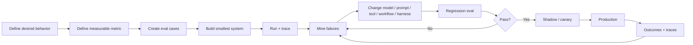
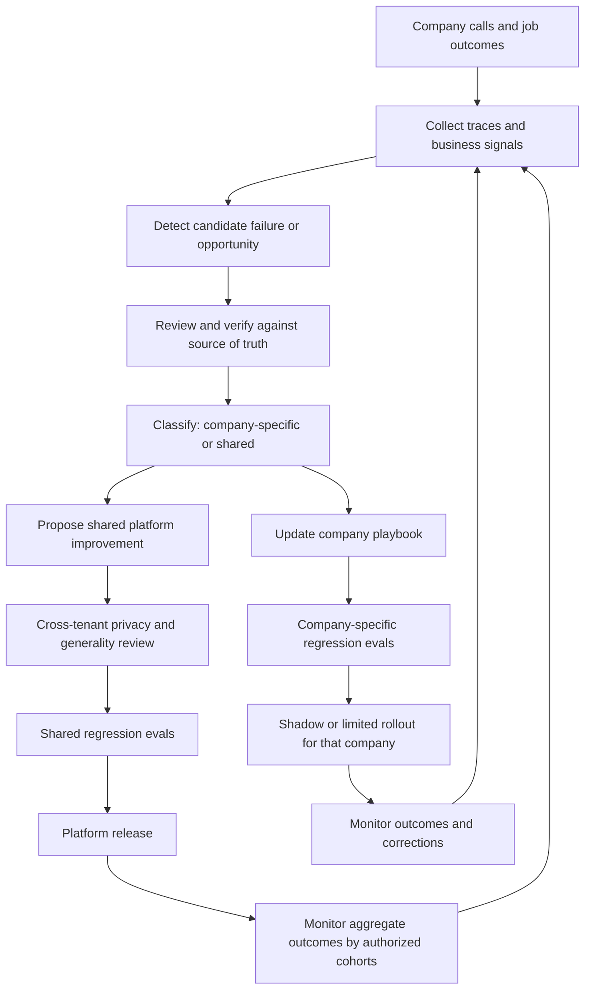

# Design by Evaluation

**Estimated reading time:** 18 minutes · **Facts checked:** October 7, 2026

Evaluation is not the last stage of agent development.

For production agents, the evaluation is part of the **design specification**: it defines
what behavior matters, exposes ambiguous requirements, creates a regression boundary, and
provides evidence for rollout decisions.

Anthropic's guidance separates an agent's transcript (every tool call and intermediate
result) from its outcome (what actually changed), recommends grading the outcome first, and
uses transcripts to check that the graders work [1]. Microsoft Agent Framework includes
evaluators for both agents and workflows [2]. OpenAI's evaluation workflow starts from traces
and graders and moves to repeatable datasets and eval runs [3]. This doc is the repo's
synthesis of those ideas; [whitepaper chapter 17, sections 3–4](whitepaper/17-running-agents-in-production.md#3-evaluation-define-success-before-changing-the-agent)
covers offline and online evaluation and canary releases in more depth.

## 1. The evaluation-first loop



The loop should start **before** implementation.

## 2. Why writing the eval early improves architecture

Suppose the requirement is:

> "Book the earliest acceptable appointment."

That sounds simple until you write the evaluation.

You may discover that "acceptable" means:

- technician skill must match;
- service area must be valid;
- customer requested a time window;
- emergency work has priority;
- travel cannot exceed a threshold;
- a higher-value job may compete for the slot;
- customer consent is required for a changed time;
- duplicate booking must never occur.

Those are not merely test cases. They are **architecture requirements**.

The eval forces the team to identify:

```text
Requirement
    |
    v
Observable behavior
    |
    v
Required state
    |
    v
Required tools
    |
    v
Policy / control boundary
    |
    v
Evaluation
```

## 3. Four layers of evaluation

A useful hierarchy is:

| Layer | Question | Example |
|---|---|---|
| Model | Did the model reason correctly? | correct intent |
| Agent | Did the agent choose the right action? | correct tool |
| Workflow | Did the system execute correctly? | correct handoff |
| Business | Did the outcome help? | valid booking, no dispatch conflict |

Do not stop at model quality.

A model can have excellent language quality while an agent makes the wrong tool call.
An agent can make the right tool call while the workflow supplies stale state.
The workflow can succeed technically while producing a poor business outcome.

## 4. Grade the outcome; inspect the trajectory

For a multi-step agent, the final response is only one observation, and it can be wrong
about itself: an agent can say "you're booked" when no job exists. Grade the **outcome**
first, meaning the state the agent left behind (does a valid job exist for this customer, in
this slot, exactly once?) [1]. Then use the trajectory for two things: checking steps that
are themselves policy, and explaining failures.

```text
Input
  |
  v
Agent
  |
  +--> tool A
  |      |
  |      v
  |    result
  |
  +--> tool B
  |      |
  |      v
  |    result
  |
  +--> retry
  |
  v
Final answer
```

Trajectory checks are worth writing where a step is policy or a known failure mechanism:

- Was the right tool selected?
- Were arguments valid?
- Did the agent use the returned result?
- Did it retry appropriately?
- Did it stop when the objective was satisfied?
- Did it violate a policy before recovering?
- Did it create unnecessary tool calls?
- Did it reach the right result for the right reason?

Avoid grading the exact sequence of steps when several paths are valid; that rewards one
script and fails correct alternatives [1].

OpenAI's trace-evaluation guidance uses traces, the "end-to-end record of model calls, tool
calls, guardrails, and handoffs for one run," as the starting point for grading [3].
Microsoft exposes evaluators for tool selection, tool input accuracy, task completion,
safety, and workflow evaluation [2].

## 5. Build the evaluation matrix before the implementation

For a voice booking capability:

| Dimension | Example criterion | Failure severity |
|---|---|---|
| Intent | identifies booking vs cancellation | medium |
| Identity | links to correct customer | high |
| Eligibility | respects service constraints | high |
| Retrieval | obtains current availability | high |
| Tool choice | uses booking tool only after checks | high |
| Tool args | passes correct customer/job/slot | critical |
| Policy | rejects disallowed booking | critical |
| State | uses current appointment version | critical |
| Idempotency | duplicate call does not duplicate booking | critical |
| Conversation | confirms important details | medium |
| Latency | meets p95 target | medium |
| Outcome | appointment is actually valid | critical |
| Escalation | defers when confidence/policy requires | high |

This table can become the test plan, instrumentation plan, and design-review agenda.

## 6. Finding failures in production

Failure mining (section 7) needs failures to mine, and the worst ones don't announce
themselves. An agent that reports success when nothing changed looks fine in its own logs. A
user who gives up rarely files a complaint. The quiet failures are the expensive ones, so
finding them has to be designed in, not left to whoever happens to notice.

This applies to any agent that takes actions: support, sales, scheduling, coding, operations.
The booking examples in brackets show what each idea looks like for a voice booking agent.

### Where the signals come from

No single signal finds everything. Use several, because each sees a different kind of failure:

| Signal source | What to look for | What it tends to catch |
|---|---|---|
| **Claims vs. the record** | the agent said it did something the system of record doesn't show; an action recorded twice; a value that differs from the one confirmed [said "booked" but no job exists] | ungrounded claims, idempotency, stale state |
| **What happened next** | the user comes back about the same thing soon; the result is undone or reworked [caller rings back; booking cancelled within a day] | wrong intent, wrong action, missing consent |
| **User behavior in the session** | abandonment mid-task; asking for a human; repeated rephrasing or corrections | misunderstanding, confusing responses, interaction problems |
| **Human corrections** | a person edits, reverses or redoes the agent's work [a CSR reverses an agent booking] | the errors people catch silently every day |
| **Operational telemetry** | tool errors, retries and timeouts; escalation rate; latency tail (p95/p99); cost per task | integration, infrastructure and runaway loops |
| **Graders and judges** | an automated judge disagrees with the outcome; low-confidence critical fields | definition (denominator) and extraction errors |
| **Drift** | the input mix shifts: a new customer segment, product, season or market | everything above, concentrated in the new traffic |

The first row is the cheapest high-value check you can run: compare what the agent **said** it
did with what the **system of record** shows, task by task. It needs no model and no human,
and it catches the failures the agent itself will never report. (The
[claims-vs-state lesson](https://sp7412.github.io/onboarding/lessons/claims-vs-state/) and
labs 07 and 13 build this check.)

### Sample two ways, for two purposes

You can't review every session, and the two reasons to review need different samples:

- **A random sample estimates rates.** Review a small uniform sample on a fixed cadence. It
  is the only unbiased estimate of how often failures happen, and it finds failure types that
  no signal is watching for yet.
- **Targeted samples find mechanisms.** Pull the sessions the signals flagged, and over-sample
  rare, high-cost segments (safety-critical requests, new segments, new markets). These find
  *why* things fail quickly, but they can't tell you *how often*, because they were chosen
  for looking bad.

Keep them labelled separately. A failure rate computed from flagged sessions is wrong by
construction; the same denominator discipline from the
[denominator lesson](https://sp7412.github.io/onboarding/lessons/denominator/) applies.

### A signal is not a failure

Treat every signal as a candidate, then confirm it:

```text
signal fires --> candidate session --> read transcript + state + trace --> confirmed?
                                                                             |
                            no: record as a false alarm (tune the signal) <--+
                            yes: classify the mechanism (section 7), score severity x frequency
```

Two habits keep the signals honest:

- **Measure each signal's precision.** Of the sessions a signal flagged, how many were real
  failures? A signal that is right 5% of the time wastes reviewers; fix it or drop it.
- **Distrust a quiet dashboard.** Zero flagged sessions can mean zero failures, or a broken
  logging path, a renamed event, or a signal that no longer fires. Run a known-bad test case
  through production occasionally and check that it is caught.

### Check the input and the delivery, not only the reasoning

Many failures that look like bad reasoning happen before or after the model:

- **What the agent received.** The model may have answered its input correctly while the
  input was wrong: a speech-recognition error, a bad OCR read, a truncated document, a parsing
  bug. Inspect the raw input before blaming the model.
- **What the user actually got.** Streaming, interruptions and truncation mean the user may
  have seen or heard only part of what was generated. Judge the interaction by what was
  delivered [after a barge-in, by what the caller heard]. The
  [heard-vs-generated lesson](https://sp7412.github.io/onboarding/lessons/heard-vs-generated/)
  shows why.
- **The interaction itself.** Timing and flow problems rarely appear in a transcript as
  errors; they show up as abandonment and repeated corrections [talk-overs and long silences
  on a call].

### Make it a routine

Failure finding works when it is a habit with an owner, not a project:

1. On a fixed cadence: review the random sample and the top flagged clusters.
2. Name the mechanism for each confirmed failure, not just the symptom.
3. Pick the top few clusters by severity × frequency and turn each into eval cases
   (section 7).
4. Track each signal's precision, and add a signal for every new failure type found only by
   the random sample.

Anthropic's eval guidance makes the same point about reading: you won't know whether your
graders work unless you read transcripts and grades from many trials [1]. OpenAI's guidance
starts from traces, which record the model calls, tool calls, guardrails and handoffs of each
run [3]. [Whitepaper chapter 17, section 2](whitepaper/17-running-agents-in-production.md#2-debugging-production-agents-and-mining-failure-cases) works a
"wrong technician" investigation end to end.

The specific signals, thresholds and review rituals at any company are team decisions. Ask
about them rather than assume; the
[question bank](first-90-days-question-bank.md#production-operations) has starting points.

## 7. Failure mining creates new evals

Production failures should feed the dataset.

```text
Production trace
      |
      v
Failure detected
      |
      v
Classify failure
      |
      +--> reasoning
      +--> retrieval
      +--> tool selection
      +--> tool args
      +--> stale state
      +--> policy
      +--> integration
      |
      v
Redacted regression case
      |
      v
Evaluation dataset
      |
      v
New implementation
      |
      v
Regression run
```

The key is to preserve the **failure mechanism**, not merely the final text.

A bad booking should become a test that captures why it was bad: stale capacity, wrong
technician, incorrect tool argument, policy violation, or something else.

## Company-specific learning loop

A multi-tenant platform needs two related but distinct learning loops:

- **Platform loop:** improves shared runtime reliability, common tool contracts, generic
  capabilities, safety controls, and reusable evaluation infrastructure.
- **Company loop:** improves that contractor's operating playbook from its own outcomes,
  approved corrections, and changing business rules.

The company loop should not mean silently fine-tuning a model on every call. It means
turning verified operational evidence into a governed, versioned update to the right layer:
company configuration, workflow rules, retrieval content, tool constraints, or—only when
justified—a model adaptation.



### What belongs in a company playbook?

Examples include service-area rules, business hours, supported trades, job-intake questions,
booking and dispatch constraints, approved customer-facing language, escalation contacts,
warranty or membership handling, and company-approved exceptions. Authoritative business
facts should remain in the relevant system of record; the playbook should reference them,
not become a competing database.

### How a company improves its playbook

1. **Observe:** collect call traces, tool outcomes, booking/job state, customer corrections,
   CSR edits, cancellations, repeat calls, and explicit feedback, subject to consent and
   retention policy.
2. **Verify:** distinguish a real failure from a noisy signal. Compare the agent's claims
   with committed state and, where appropriate, have an authorized company operator confirm
   the intended business rule.
3. **Classify:** determine whether the finding is company-specific, a shared platform defect,
   or a broader candidate pattern. A single company's preference must not become a global
   default.
4. **Propose a change:** make the smallest auditable change to a rule, workflow, retrieval
   source, tool contract, prompt, or model. Record its rationale, owner, evidence, and version.
5. **Evaluate:** run that company's regression set, including critical safety and business
   invariants. Use representative successful cases as well as failures.
6. **Roll out:** shadow or canary the change for that company, with a rollback path and
   company-appropriate guardrails. Require approval for changes that alter commitments,
   pricing, eligibility, safety, or other high-impact policy.
7. **Measure:** check committed outcomes, human corrections, repeat contacts, valid booking
   rate, escalation correctness, latency, and cost. Promote only when evidence supports it.
8. **Continue learning:** add confirmed incidents to the company's regression set and review
   whether the change actually reduced the targeted failure without causing new ones.

### Tenant boundaries and safe reuse

The default is strict tenant isolation for raw transcripts, customer records, company rules,
embeddings, playbook versions, and company-specific evaluation examples. Cross-company reuse
should follow an explicit policy:

- Reuse generic fixes when they are genuinely tenant-independent, such as a retry bug fix.
- Consider aggregate patterns only with appropriate privacy controls, minimum cohort sizes,
  and authorization.
- Never copy one contractor's prices, customer details, exceptions, or private operating
  procedures into another contractor's playbook.
- Treat a proposed shared improvement as a hypothesis until it passes shared evaluations and
  governance review.
- Keep a version history and audit trail so an operator can see what changed, why, who
  approved it, what evidence supported it, and how to roll it back.

### Example

If one HVAC company repeatedly corrects the agent because it requires a model number before
booking a particular repair, that may be a company-specific intake rule. If multiple
companies experience duplicate bookings after a tool timeout, that is likely a shared
idempotency defect in the execution layer. Both can enter the learning pipeline, but they
should not be applied at the same scope.

**The objective is not for the agent to rewrite its own rules without oversight.** It is for
the platform to turn verified outcomes into controlled improvements at the narrowest
appropriate scope, with evidence that each company's service quality improves over time.

## 9. Evaluation changes architecture

An evaluation can tell you that a problem is not a model problem.

For example:

**Observation:** the agent chooses the correct appointment 99% of the time in a static
dataset but duplicates bookings under retries.

**Conclusion:** more prompt tuning is unlikely to solve the primary failure.

**Architecture change:** add idempotency to the execution harness.

Another example:

**Observation:** the agent succeeds overall, but performance collapses when the customer's
requested window conflicts with technician capacity.

**Architecture change:** promote capacity and constraints into authoritative shared state
and make arbitration explicit.

Thus:

> **A good evaluation does not merely score the architecture. It tells you what architecture
> you need.**

## 10. Evaluation and rollout

Evaluation should be connected to release controls:

```text
Offline eval
    |
    v
Regression gate
    |
    v
Shadow traffic
    |
    v
1% canary
    |
    v
10% / 25% / 50%
    |
    v
100%
```

At each stage monitor both quality and guardrails.

Examples:

- wrong-action rate;
- escalation rate;
- tool failure rate;
- duplicate side effects;
- latency;
- cost;
- customer effort;
- business outcome.

A candidate that improves task completion but increases critical side effects should not
be promoted.

## 11. The design-review questions

Before implementation, ask:

1. What behavior are we trying to change?
2. Who is the eligible population?
3. What is the denominator?
4. What counts as success?
5. What counts as a critical failure?
6. What intermediate behavior matters?
7. What state must be authoritative?
8. What tools are required?
9. What actions need deterministic controls?
10. What requires HITL?
11. How will traces expose failures?
12. What evaluation detects regression?
13. What rollout evidence permits promotion?
14. What evidence causes rollback?

If these cannot be answered, the design is probably underspecified.

## 12. The core mental model

Do not think:

> Build agent → test agent → deploy agent.

Think:

> **Define behavior → define evidence → design system → build → trace → evaluate → learn.**

That is **design by evaluation**.

## Sources

Checked October 7, 2026.

1. [Anthropic: Demystifying evals for AI agents (January 9, 2026)](https://www.anthropic.com/engineering/demystifying-evals-for-ai-agents)
2. [Microsoft Agent Framework: evaluation](https://learn.microsoft.com/agent-framework/agents/evaluation)
3. [OpenAI: evaluate agent workflows](https://developers.openai.com/api/docs/guides/agent-evals)

Related: [evaluating voice agents](evaluating-voice-agents.md), [earning autonomy](earning-autonomy.md),
[agent harness](agent-harness.md), [comparative agent architectures](comparative-agent-architectures.md).

## Technician-specific personalization

Company-level learning is not the only useful scope. An estimating agent can also adapt to
an individual technician's established workflow and presentation preferences, while remaining
inside company policy. Treat this as a distinct, versioned **technician profile**, not as a
separate fine-tuned model by default.

Keep three sources of context separate:

| Scope | Examples | Authority |
|---|---|---|
| Company playbook | Price book, labor rates, discount limits, warranty terms, required disclosures | Company systems and authorized policy owners |
| Technician profile | Preferred estimate layout, option ordering, explanation style, recurring workflow preferences | Verified preferences and technician-approved settings |
| Job context | Equipment/model, diagnostic evidence, requested work, site conditions | Current job record and verified observations |

### Learning from estimate edits

The agent can compare its draft with the technician's final approved estimate and use
repeated, verified patterns as candidate preferences. Examples include preferring good/better/best
options, surfacing diagnostic evidence first, using a concise customer explanation, or
consistently adding a required inspection step for a particular job type.

Do not treat every edit as a preference. Classify the difference before learning from it:

- **Presentation preference:** ordering, wording, level of detail, or layout. Usually safe to
  propose as a profile preference.
- **Workflow preference:** the sequence of checks or information surfaced. Validate against
  required procedures before adopting it.
- **Factual correction:** wrong equipment, measurements, diagnosis, or scope. Correct the
  underlying job data or retrieval path; do not encode it as style.
- **Commercial or policy change:** price, discount, warranty, eligibility, safety, or a customer
  commitment. Never infer permission from repeated behavior; require the authoritative rule
  and the required approval.

### Evaluation and rollout

1. Start with explicit settings and a small structured profile; do not fine-tune one model per
   technician as the default.
2. Capture the proposed estimate, technician edits, final approved estimate, applicable price
   book/version, job type, and eventual outcome with appropriate access and retention controls.
3. Propose a preference only after repeated evidence or explicit technician confirmation.
4. Evaluate against that technician's representative jobs and a shared set of company-policy
   invariants. Include regressions where personalization must not change the price, scope,
   required disclosure, or authorization.
5. Roll out to that technician in shadow mode or as a visible suggestion; show what was learned,
   allow correction/disable/reset, and retain version history and rollback.
6. Measure edit distance and edit categories, time to approved estimate, estimate accuracy,
   policy violations, conversion and rework—without optimizing conversion at the expense of
   correct scope or customer trust.

The profile must be scoped to the authorized technician and company, with explicit handling
for shared devices, technician changes, and access revocation. One technician's preferences
must not silently transfer to another technician or another company.

**Design rule:** personalize how the agent prepares and explains an estimate; keep pricing,
eligibility, factual job state, and commitments governed by authoritative systems and explicit
controls.
