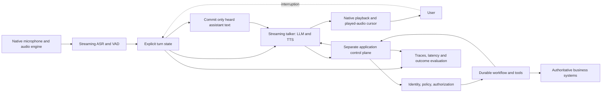

# On-device voice agents: architecture patterns worth borrowing

**Research status:** October 21, 2026  
**Decision:** Keep as an architecture research item; do not fork a demo or commit to an on-device production stack yet.

## Five takeaways

1. **The reusable idea is the audio/turn-control architecture, not the angel-and-devil UI.** Native audio capture, echo cancellation, explicit turn state, streaming speech, barge-in, cancellation, and playback-aware context are broadly useful.
2. **“Pipecat on iOS” describes two different deployment models.** Little Voices and Pipecat Build iOS embed Python and local models on the phone; the Pipecat iOS client SDK is a client library for an application that connects through a transport to an agent elsewhere.
3. **Interruption correctness deserves first-class design.** Keep capture alive during playback, cancel the active generation/playback on barge-in, and commit only speech that actually played to the conversation history.
4. **Local inference is an option, not a production architecture by itself.** The demos do not supply ServiceTitan business integrations, authoritative scheduling state, authorization, durable workflow orchestration, or verified booking outcomes.
5. **Prototype against measured acceptance criteria before choosing a stack.** Compare turn latency, interruption response, task success, recovery behavior, device/resource cost, privacy, and operational complexity on representative hardware.

## Why this is worth investigating

[Pipecat Little Voices](https://github.com/pipecat-ai/ios-little-voices) is a useful end-to-end reference for a conversational pipeline running on an iPhone. Its published architecture combines a shared echo-cancelled `AVAudioEngine`, Apple on-device speech recognition and voice activity signals, an embedded Python/Pipecat pipeline, on-device speaker selection, Apple Foundation Models, local Phonon TTS, and playback-driven lip sync. The native/Python boundary is an explicit JSON-event bridge rather than a socket or subprocess.

The interesting engineering is the coordination: generation is incremental, speech is emitted sentence by sentence, capture remains active while the assistant speaks, and text is committed to context only after it has actually played. The demo's language model writes text only; it has no tool-execution capability. It is therefore a strong reference for interaction and audio mechanics, not a ready-made business-agent backend.

## Compare the deployment patterns

| Project | Where inference and orchestration run | What it is useful for | Important limits |
|---|---|---|---|
| [Pipecat Little Voices](https://github.com/pipecat-ai/ios-little-voices) | On iPhone; embedded Python plus native iOS services and local models | Audio lifecycle, native/Python bridge, streaming sentence generation, played-text context, barge-in | Entertainment demo; no business tools; README currently lists macOS 27/Xcode 27/iOS 27 requirements, which must be rechecked before attempting a build |
| [Pipecat Build iOS](https://github.com/pipecat-ai/pipecat-build-ios) | On iPhone; embedded Python, Apple speech services, local Foundation Models and PocketTTS | A second implementation of local Pipecat, with a different TTS/runtime path and physical-device validation notes | Still a local mobile demo; validate current repository state, hardware support, acoustic behavior, and model trade-offs |
| [local-voice](https://github.com/mthomas100/local-voice) | Local voice server on Apple silicon; iPhone/Mac clients connect to it | Streaming ASR/LLM/TTS, spoken approvals, scoped tool access, measured interruption behavior | Prototype; network hop and server lifecycle remain; its reported latency figures are author-reported test results, not independent benchmarks |
| [Pipecat iOS client SDK](https://github.com/pipecat-ai/pipecat-client-ios) | Client UI/audio transport is separate from the agent runtime | Native iOS client for a transport-backed Pipecat agent; a cleaner comparison point for a hosted backend | The base SDK has no transport by itself; select a supported transport integration. It does not imply that model inference runs on the phone |

These are distinct designs, not interchangeable packages. The embedded examples optimize for local execution and device privacy; the client-SDK pattern is more natural when the agent needs shared backend services, larger models, centralized observability, or enterprise tool integrations.

## Architecture pattern to reuse

The diagram is a target pattern, not a claim that the cited demos implement every box. In particular, keep the application control plane and durable workflow separate from the conversational talker.

### State and cancellation contract

Use explicit IDs and states rather than relying on prompt wording alone:

- Assign a `turn_id` and generation/cancellation token to each user turn.
- Track listening, endpointing, thinking, speaking, interrupted, completed, and failed states.
- On barge-in, stop playout promptly, cancel outstanding generation/TTS work, and prevent stale chunks from entering the next turn.
- Track the amount of assistant audio actually played. Commit only corresponding text to conversation context; mark generated-but-unplayed text as cancelled or discarded.
- Correlate ASR, model, TTS, playback, tool, policy, and final outcome events with one trace ID.
- Make cancellation idempotent. A late callback from an old turn must not restart audio or mutate the current turn.
- Keep tool state and business outcomes authoritative outside the talker. Never infer a successful booking from a fluent spoken confirmation.

## Application to a production scheduling voice agent

The strongest adaptation is not “run the whole ServiceTitan agent on the iPhone.” The phone demo is an architecture laboratory for the conversational edge. A production call agent still needs the transport and business workflow that owns identity, tenant configuration, scheduling constraints, availability, authorization, idempotency, commits, reconciliation, escalation, and audit.

Use a two-plane design:

- **Real-time conversation plane:** audio transport, endpointing, ASR, talker, streaming TTS, barge-in, turn state, and low-latency user feedback.
- **Authoritative control/workflow plane:** typed intent and evidence, policy checks, tool execution, source-of-truth reads/writes, durable state, retries, verification, escalation, and business-outcome telemetry.

The model can propose what to say or what action to request. The harness decides whether the action is allowed, executes it, verifies the result, and returns a structured outcome for the talker to communicate.

## Prototype plan

Start with a narrow, transport-independent interruption test rather than a full app rewrite.

1. **Read and map:** inspect Little Voices' pipeline, native bridge, playback/turn lifecycle, privacy notes, and tests; compare the same paths in Pipecat Build iOS and local-voice.
2. **Write a minimal event contract:** user-turn start/final transcript, assistant sentence generated, audio playback started/progressed/finished, interruption, cancellation, tool proposal/result, and turn outcome.
3. **Build a scripted harness:** deterministic fake ASR/LLM/TTS delays and controllable callbacks so race conditions can be tested without live model variability.
4. **Exercise failure cases:** interrupt during first audio, cancel while TTS is synthesizing, late audio after cancellation, empty transcript, false VAD start, duplicate end-of-turn, tool timeout, retry after an ambiguous commit, and disconnect/reconnect.
5. **Benchmark real hardware only after correctness tests pass:** report p50/p95/p99 end-of-speech-to-first-audio, barge-in-to-silence, endpointing delay, dropped/late audio, task success, and CPU/memory/battery. Split warm and cold starts and disclose device, model, and test conditions.
6. **Choose deployment from requirements:** on-device for offline/privacy/latency cases where supported models and battery budget suffice; client-to-service for centralized business integrations and larger models; hybrid only when its failure and state synchronization behavior is tested.

### Proposed initial acceptance criteria

These are proposed targets for a prototype, not measured claims about any repository:

| Measure | Initial target or rule |
|---|---|
| Warm end-of-speech to first audible response | p95 under 1.0 s for a simple no-tool turn |
| Barge-in | Audio stops promptly; no stale audio resumes after cancellation |
| Context integrity | No unplayed assistant text is committed as heard |
| Tool safety | No side effect without authorization; verify against authoritative state |
| Failure recovery | Duplicate events/retries cannot create duplicate business actions |
| Evaluation | Repeatable traces and scripted regressions; report p50/p95/p99 and failure counts |
| Privacy | Explicitly document audio/transcript retention, network calls, model downloads, and telemetry |

The latency target is a hypothesis to validate, not a release gate until a representative device, test set, and measurement method are specified.

## Privacy, licensing, and operational checks

- Read each project's license and each model/runtime license independently before reusing code, weights, or voice assets.
- Verify whether model downloads occur only at setup or also at runtime; distinguish network access by the app from OS-managed asset downloads.
- Treat “on-device” as a deployment claim to verify in source and with network observation, not a blanket privacy guarantee.
- Test real acoustic conditions: speakerphone echo, background noise, quiet speech, overlapping speech, Bluetooth routes, audio-session interruptions, foreground/background transitions, and device thermal pressure.
- Check the exact Xcode/iOS/Swift/Python versions in the repository at the time of evaluation. The README requirements may change and may exceed the available build environment.
- Do not copy customer data, recordings, internal implementation details, or credentials into this public onboarding repository. Keep the exercise synthetic and public-source based.

## Recommendation

**Add this to the research backlog, not the production stack.** The next high-value experiment is a small interruption-and-context-integrity test harness with deterministic event traces. That tests the most reusable insight across mobile, browser, and phone-call agents without coupling the onboarding project to one iOS demo or one model vendor.

## Sources

1. [Pipecat Little Voices README](https://github.com/pipecat-ai/ios-little-voices) — models, build requirements, behavior, and setup.
2. [Little Voices architecture](https://github.com/pipecat-ai/ios-little-voices/blob/main/docs/architecture.md) — pipeline, native services, turn behavior, and played-text handling.
3. [Little Voices privacy notes](https://github.com/pipecat-ai/ios-little-voices/blob/main/docs/privacy.md) — stated data handling and network behavior.
4. [Pipecat Build iOS](https://github.com/pipecat-ai/pipecat-build-ios) — alternate embedded-Python/local-TTS implementation.
5. [local-voice](https://github.com/mthomas100/local-voice) — local server, client architecture, tools/approvals, and project-reported latency tests.
6. [Pipecat iOS client SDK](https://github.com/pipecat-ai/pipecat-client-ios) — client library boundary and transport integration.
