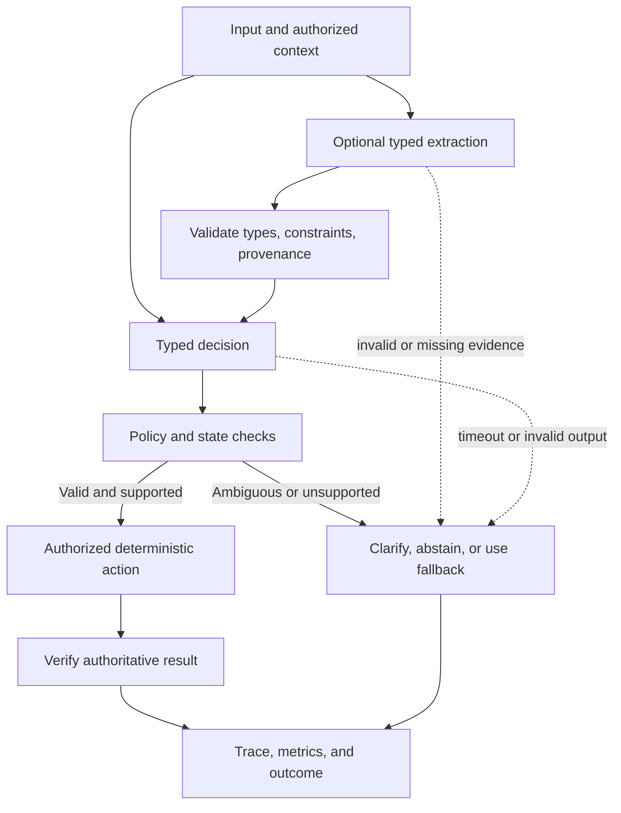

# System One Models for Production AI Systems

**Purpose:** decide when a typed decision or extraction model is a better component than a general-purpose generative model, and how to evaluate it safely.

**Status:** architecture and evaluation guide. Product names, capabilities, and vendor performance claims must be checked against current primary documentation before adoption.

## The useful distinction

Daniel Kahneman's *System 1* and *System 2* are a helpful analogy, not a literal taxonomy of neural-network products. Here, **System One models** means models designed to return a bounded, typed prediction for a specific task. **System Two** is shorthand for broader generative models used when the task needs flexible language, synthesis, or multi-step reasoning.

The engineering distinction is the interface and operating contract—not simply model size or speed.

| Property | Typed decision/extraction model | General-purpose generative model |
|---|---|---|
| Primary contract | Predict a bounded label, score, or schema | Generate flexible content or reasoning |
| Output handling | Validate a known type and domain | Parse/validate content; schema-constrained output may help |
| Best fit | Repeated, narrow, measurable subproblems | Ambiguous requests, synthesis, explanation, complex reasoning |
| Main risks | Taxonomy mismatch, distribution shift, misleading scores, narrow coverage | Hallucination, variable latency/cost, format drift, overbroad action proposals |
| Required controls | Validation, thresholds, abstention, fallback, evaluation | The same controls, plus stronger content/tool-use boundaries where applicable |

A typed result can reduce parsing and simplify downstream software. It does **not** prove the prediction is correct, the score is calibrated, or the service is faster end to end. Measure those properties for the actual task and deployment.

## Two task families

### 1. Decision models: choose, score, or answer a bounded question

Decision tasks map evidence and context to a finite or explicitly defined outcome. Examples include call-intent classification, routing category, urgency tier, or whether a request meets a stated criterion.

Vendor terminology and available output types vary. A product may expose a choice among labels, a score, or a yes/no-style decision with a score. Do not assume these are interchangeable:

- **Choice/classification:** select one label from a versioned set.
- **Score/ranking:** estimate a task-specific score; define what higher values mean and how ties are handled.
- **Yes/no decision:** return a binary judgment for an explicitly defined proposition.
- **Confidence/probability:** use this wording only when the API defines the semantics. A raw model score is not automatically a calibrated probability.

For a voice-agent example, a decision model may predict `schedule_service`, `reschedule_service`, `appointment_status`, `emergency_or_safety`, or `other_or_unclear`. The application still owns policy, authorization, workflow state, tool invocation, and booking confirmation. A predicted intent is not permission to act and is not a determination that the job is bookable.

### 2. Extraction models: turn evidence into typed fields

Extraction tasks map text or other input to structured values: dates, amounts, entities, spans, lists, categorical attributes, or numerical estimates. Some tasks are direct extraction; others are regression or forecasting and therefore require a different validation strategy.

For each field, define:

- **Type and constraints:** string, enum, date, integer, range, nullable value, or list; allowed units, bounds, and missing-value behavior.
- **Provenance:** the source span, record, or input evidence that supports the value, where the product provides it.
- **Uncertainty:** missing, ambiguous, conflicting, or out-of-distribution evidence must be representable.
- **Validation:** parse dates, check units and bounds, reconcile conflicting fields, and preserve the raw source.
- **Task-specific metrics:** exact match and span overlap for extraction; MAE/RMSE and interval coverage for numerical estimates; field-level precision/recall for entities.

Do not treat a forecast as an extracted fact. Forecasts need time-aware backtesting, leakage checks, and prediction-interval evaluation. A provenance span shows where a value may have come from; it does not itself prove the value is correct.

### Product names are not contracts

Jev is covered separately in the [Jev call-intent classification guide](jev-call-intent-classification.md). Other products may use names such as Clef for decisions or Clairic for extraction. Treat those names and feature descriptions as discovery leads, not substitutes for current official API documentation. Before designing around a vendor, verify the exact supported types, SDK/API contract, score semantics, latency methodology, limits, data handling, and availability. This guide does not assert that every listed capability is currently available in every product or plan.

## A practical architecture

Prefer a narrow typed component when the task is bounded and measurable. Keep validation and actions in ordinary application code.

This is a design pattern, not a mandatory sequence for every task. If extraction and decision are independent, parallel execution may reduce latency. If the decision needs extracted fields, run extraction first. If the input is already structured and trusted, extraction may be unnecessary.

A robust control loop is:

1. Build the request from permitted context and a versioned task definition.
2. Call the narrow model with bounded timeout, concurrency, and retry policy.
3. Validate response shape, labels, units, ranges, and required evidence.
4. Apply policy to the validated result; use explicit thresholds only when justified by evaluation.
5. Abstain, clarify, or fall back on missing evidence, ambiguity, invalid output, timeout, or drift.
6. Execute only authorized actions; verify their outcome against the authoritative system.
7. Log model/version, task/schema version, latency, output, validation/fallback reason, route, and final outcome under appropriate privacy and retention controls.

**Model proposes; the harness controls.** A model's label, score, or extracted field is an input to policy—not the policy itself.

## How to choose the component

Use a typed decision or extraction model when all or most of these are true:

- The task recurs frequently and has a stable, reviewable definition.
- Inputs and outputs can be represented with a clear schema.
- A wrong answer can be labeled and measured against a trusted reference.
- Latency or cost matters enough to justify a dedicated component.
- Ambiguity and out-of-scope inputs can be handled through abstention, clarification, or fallback.

Prefer a general-purpose model—or combine it with a typed model—when the task requires open-ended explanation, multi-document synthesis, novel planning, or nuanced reasoning that cannot be reduced safely to a bounded contract. A hybrid design is common: a generative model handles conversation and complex reasoning; typed components perform well-defined classification or extraction; deterministic code validates and executes.

Do not select based on a vendor's headline tokens-per-second or single latency number alone. Measure end-to-end p50/p95/p99, timeout/error rate, quality, fallback rate, and cost on the target workload, including network and orchestration overhead.

## Evaluation plan

Create a frozen, human-reviewed test set before comparing approaches. Include representative cases, rare high-cost classes, ambiguous examples, malformed inputs, corrections/negation, missing fields, conflicting evidence, and out-of-taxonomy examples. Keep a separate development set for prompt, taxonomy, and threshold tuning.

| Dimension | Decision task | Extraction task |
|---|---|---|
| Core quality | Macro-F1, per-class precision/recall, confusion matrix, cost-weighted error | Field-level precision/recall, exact match, span overlap, schema-valid rate |
| Uncertainty | Coverage vs selective accuracy; calibration metrics only for meaningful scores | Missing/ambiguous-field handling; interval coverage where applicable |
| Reliability | Invalid-label rate, abstention, timeout/error, fallback rate | Parse/constraint failure, unsupported-value rate, provenance correctness |
| Operations | p50/p95/p99 latency, cost per 1,000 requests | p50/p95/p99 latency, cost per 1,000 records |
| Downstream outcome | Incorrect route, missed escalation, task completion | Correct downstream decision, correction rate, verified outcome |

Evaluate the typed model and a reasonable baseline on the **same examples**, with the same context and outcome definitions. Report per-class and per-field results, not just aggregate accuracy. For probabilistic outputs, assess calibration on held-out data and monitor drift; do not infer calibration from a field named `confidence`. For numerical estimates, check residuals across relevant slices and whether prediction intervals achieve their stated coverage.

Roll out in shadow mode first. Shadow predictions must not change live behavior. Review disagreement cases, set explicit release/rollback gates, and canary only after operational and safety owners agree on acceptable error rates. Monitor for taxonomy changes, input drift, provider changes, and shifts in abstention or fallback rates.

## Worked voice-agent exercise

Use the existing [Lab 17 — Jev decision workbench](../labs/17_jev_decision_workbench.ipynb) to build a small, fictional call-intent dataset.

1. Freeze a balanced set of caller utterances, including corrections, ambiguous requests, emergency language, and requests for a human.
2. Compare a simple deterministic or general-model baseline with the typed decision approach on the same held-out set.
3. Record macro-F1, per-class recall, invalid-output rate, abstention/clarification rate, and p50/p95/p99 latency.
4. Add a policy gate that routes low-confidence or unsupported predictions to clarification; verify that a model result cannot call a booking tool directly.
5. Add a separate extraction exercise for appointment date and service type. Store source spans when available, reject invalid dates, and distinguish absent evidence from a guessed value.
6. Test end-to-end outcomes and failure behavior, not only model output quality.

Keep all examples fictional or properly approved and privacy-reviewed. Live API calls should be opt-in, use personal credentials, and never be required to complete the offline exercise.

## Adoption checklist

- [ ] Current vendor docs confirm API fields and supported types.
- [ ] Score and probability semantics are documented and tested.
- [ ] Schema, taxonomy, units, and task version are explicit.
- [ ] Missing, ambiguous, conflicting, and out-of-scope inputs are handled.
- [ ] Frozen evaluation set and baseline exist.
- [ ] Quality, calibration where applicable, latency, cost, and downstream outcomes meet agreed gates.
- [ ] Timeout, provider failure, invalid output, and fallback paths are tested.
- [ ] Policy, permissions, side effects, logging, privacy, and rollback remain application-controlled.

## Further reading

- [Jev call-intent classification](jev-call-intent-classification.md) — task-specific decision-model integration and evaluation.
- [Earning autonomy](earning-autonomy.md) — uncertainty, drift, evidence thresholds, and staged promotion.
- [Realtime voice-agent evaluation](realtime-voice-agent-evaluation.md) — end-to-end voice-agent evaluation and release gates.
- [Agent harness](agent-harness.md) — the application boundary around model proposals and tool execution.
